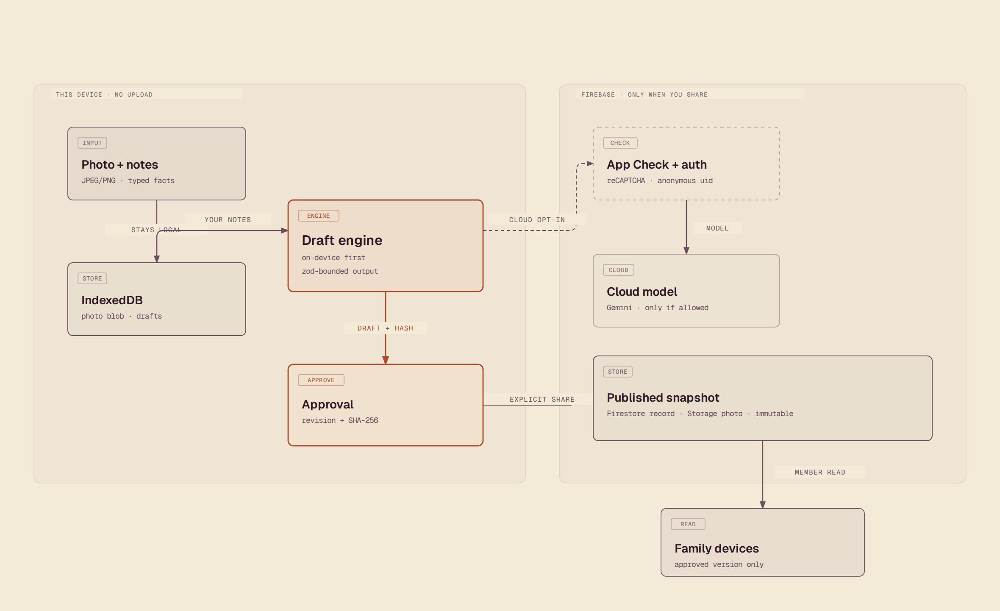

# Kinwoven

<p align="center"></p>

**The photo is saved. The story is still yours to tell.**

Kinwoven helps a family turn one photo and a few remembered details into a short, approved story
and an accessible show. A grandparent sees one photo and one gentle question at a time; the family
confirms the words; playback uses only the version they approved.

## See it work

[Watch the two-minute demo](docs/media/kinwoven-demo.mp4) with sound on. It follows one
synthetic photo from capture to approval, then ends on the architecture below. The photo in the
demo and the still fixtures in `assets/generated/` are AI-generated test material, not family
media; the film labels the photo on screen.

## Architecture



[SVG](docs/diagrams/architecture.svg) · [editable diagram source](docs/diagrams/architecture.html)

The left zone never uploads. The dashed route is the only cloud path and is chosen per draft.
Approval binds a revision to a SHA-256 hash. Sharing is a separate, confirmed action that writes
an immutable snapshot for family devices to read.

## Status: on-device-proven, cloud-unproven

- Working: local capture, notes, question, editable draft, revision-bound approval, story player,
  IndexedDB persistence, and a publishing path for an explicitly approved snapshot.
- Proven: on-device drafting through Firebase AI Logic in branded Chrome 157 on a Modal Linux CPU
  container, using the synthetic fixture. The SDK reported `on_device`; the UI rendered the draft as
  on-device and no Firebase or Google request occurred during the draft. See the
  [proof screenshot](docs/media/on-device-modal.png) and [redacted evidence](docs/media/on-device-modal-evidence.json).
  The Firebase config was a local test-only placeholder; this is not a real project or App Check proof.
- Implemented but unproven: cloud inference, App Check attestation with a real Firebase project,
  anonymous sign-in, Firestore/Storage publishing, and app-level offline drafting. The raw Chrome
  Prompt API completed offline, but the app-level retry timed out.
- The interface and the full local flow (photo, notes, question, draft, approval, playback) were
  rendered and driven in moli 1.1.24 and again in actual Chrome during the on-device proof.
- The plain draft path (`kind: 'template'`) exists so the product stays usable without a model. It is
  labelled in the UI and is not AI output.
- The on-device model can add generic filler or details not in the notes. Source ids are checked, but
  semantic factuality is not guaranteed; every draft still needs family editing and approval.

Checks actually run are listed in [docs/PROGRESS.md](docs/PROGRESS.md). Setup for a reviewer with
supported hardware is below.

## Run it

```bash
npm install
npm run dev        # http://localhost:5173
npm test
npm run build
```

No Firebase project is needed to try capture, drafting, approval and playback on one device. The app
opens straight into the local flow; there is no account step.

## Connect Firebase (needed for AI drafting and family sharing)

1. Create a Firebase project and register a Web app. Open **AI Services → AI Logic** and follow the
   guided setup; choose the Gemini Developer API for the free tier.
2. Copy the web config into `.env.local` from [.env.example](.env.example). These values are public
   identifiers; no private key belongs in a web app.
3. Register a **reCAPTCHA v3** App Check provider and put its site key in `VITE_APPCHECK_SITE_KEY`.
   For localhost only, set `VITE_APPCHECK_DEBUG=true`, then register the debug token printed in the
   console under **App Check → Apps → Manage debug tokens**. Never ship that flag.
4. Enable **Authentication → Anonymous**, create a **Firestore** database and a **Cloud Storage**
   bucket. Deploy the rules:

```bash
npx firebase-tools deploy --only firestore:rules,storage
```

5. On-device drafting requires **Chrome on desktop 139+** with the Chrome Prompt API available, per
   the [Firebase hybrid docs](https://firebase.google.com/docs/ai-logic/hybrid/web/get-started).
   Check `await LanguageModel.availability()` before blaming the app.

### Family spaces

Membership documents live at `familySpaces/{spaceId}/members/{uid}`. Create them in the Firebase
console or with an admin script; clients cannot write them. A member must exist before that account
can read or publish stories. Publishing writes
`familySpaces/{spaceId}/stories/{storyId}` and the photo at
`families/{spaceId}/stories/{storyId}/{revision}-{hash}.{jpg|png}`.

## How privacy is enforced

- Photo blobs and drafts are stored in IndexedDB on the device. There is no application upload in
  the local flow.
- The privacy choice applies per draft. The default sends `ONLY_ON_DEVICE`; choosing cloud sends
  `PREFER_ON_DEVICE` and is the only path that can reach a hosted model.
- Every draft records what the SDK reported in `response.inferenceSource`, plus wall-clock duration,
  prompt version and the fact ids cited. A cloud result on a local-only request is treated as an
  error and is not saved.
- Drafts are parsed and bounded by zod before rendering; citations to facts the family never entered
  are rejected. Text renders as text, never as HTML.
- Approvals bind to a revision and a SHA-256 content hash covering the words, cited sources and
  photo id. Any later edit clears the approval, and playback reads only the stored snapshot.
- Writes compare the stored revision first, so a stale tab cannot overwrite a newer revision.

## Project layout

```
src/
  lib/db.ts          IndexedDB memories and photo blobs, revision-guarded writes
  lib/revision.ts    snapshot creation, approval validity, hashing
  lib/inference.ts   Firebase AI Logic hybrid request, readiness, source checking
  lib/policy.ts      privacy choice → InferenceMode, local-only source guard
  lib/schema.ts      zod validation of untrusted model output
  lib/template.ts    labelled non-AI draft from the family's own words
  lib/share.ts       approved-snapshot publishing with a membership preflight
  screens/           Welcome, Capture, Question, Draft, Play, Share
firestore.rules      membership-only access; published snapshots are immutable
storage.rules        private family media, member-only, bounded size and type
```

## Known limits

- On-device model drafts can contain unsupported filler; human editing and approval are required.
- English is the only tested language. No speech capture, native Android, TV app or multilingual
  promise is made.
- Playback uses one photo per memory; multi-photo stories are not built.
- App Check protects cloud access; it is not a substitute for the membership rules.
- `DELETE` of published stories is denied by design. Removing local stories deletes them from this
  device only.

Licensed under the [MIT License](LICENSE).
